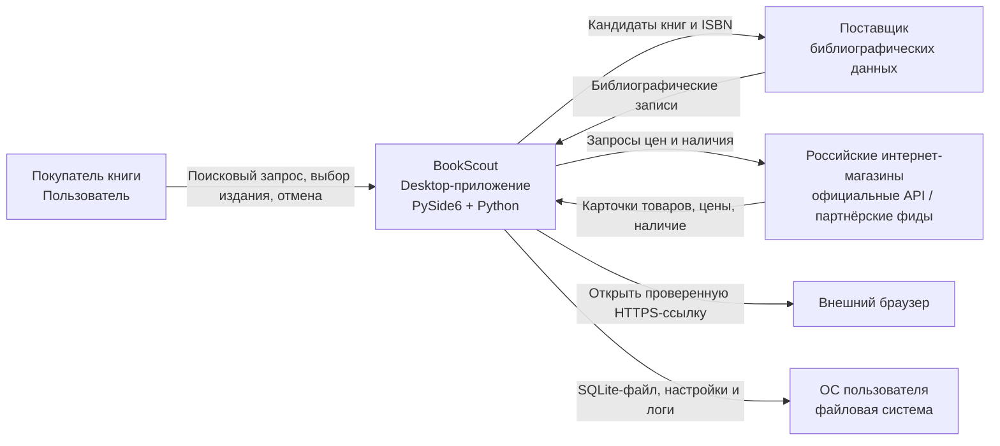
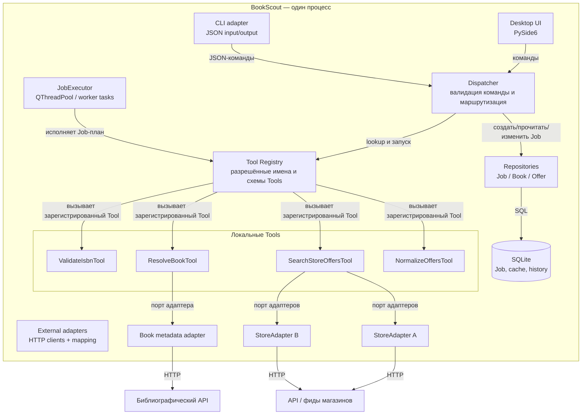
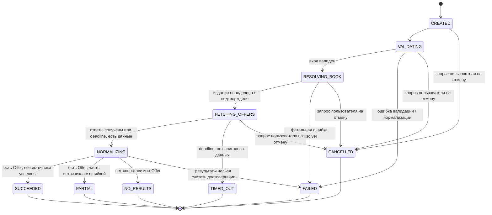

# Архитектура BookScout

**Статус документа:** целевая архитектура MVP  
**Дата:** 2026-11-14  
**Архитектурный стиль:** desktop-приложение, модульный монолит, локальные Tools.

## 1. Границы системы и контекст (C4 — Context)

**Что показывают стрелки:** сплошные стрелки — runtime-взаимодействия/вызовы и передача данных через границу системы. Это не зависимости исходного кода. В частности, магазины и поставщик библиографических данных не импортируют код BookScout и не управляют его жизненным циклом.

### Участники и внешние системы

- **Покупатель книги** — вводит ISBN или название, выбирает издание, просматривает цены, отменяет поиск и открывает карточку товара.
- **Поставщик библиографических данных** — внешний источник для поиска записей и метаданных книг; конкретный поставщик включается после проверки покрытия и условий использования.
- **Российские интернет-магазины** — источники карточек товаров, цен и наличия через разрешённые API или партнёрские фиды. Список определяется конфигурацией релиза.
- **Внешний браузер** — открывает проверенную HTTPS-ссылку на карточку товара.
- **ОС пользователя** — предоставляет локальное хранение SQLite, конфигурации и логов.

BookScout не принимает оплату, не оформляет заказ, не гарантирует актуальность цены после перехода в магазин и не является сервером или облачным API.

## 2. Компоненты внутри BookScout

**Что показывают стрелки:** сплошные стрелки внутри границы — вызовы/передача управления во время выполнения. Стрелки от Tool к адаптеру показывают вызов порта (абстракции); конкретная реализация адаптера зависит от внешнего API. Стрелки к SQLite показывают операции репозитория с хранилищем. На уровне исходного кода зависимости направлены внутрь: UI/CLI зависят от application-команд; Dispatcher — от интерфейса Registry и репозиториев; Tools — от доменных моделей и интерфейсов адаптеров; конкретные адаптеры реализуют эти интерфейсы. Внешние API не зависят от кода BookScout.

### Ответственность и скрываемая сложность

| Компонент | За что отвечает | Что скрывает от соседей |
|---|---|---|
| Desktop UI (PySide6) | Ввод запроса, выбор издания, прогресс, результаты и отмена | Потоки, сетевые протоколы, SQL и формат ответов магазинов |
| CLI adapter | Принимает JSON-команды и возвращает JSON-ответы для автоматизации/диагностики | Внутренние классы, потоки и детали хранения |
| Dispatcher | Проверяет envelope команды, проверяет права операции, маршрутизирует и связывает Job с результатом | Конкретные реализации Tools, адаптеров и SQL-запросов |
| Tool Registry | Хранит allowlist Tools, их имена, версии и схемы входных данных | Механизм регистрации и поиска реализаций |
| ValidateIsbnTool | Проверяет контрольную сумму ISBN-10/13 и нормализует ISBN-13 | Правила ISBN и детали нормализации |
| ResolveBookTool | Находит библиографические кандидаты по ISBN/названию | Формат и особенности конкретного библиографического провайдера |
| SearchStoreOffersTool | Запрашивает предложения у выбранных магазинов | Параллелизм, HTTP, лимиты и различия API магазинов |
| NormalizeOffersTool | Проверяет ISBN/издание, приводит цены и ссылки к модели Offer, удаляет дубликаты и сортирует | Различия схем и единиц измерения внешних ответов |
| JobExecutor | Выполняет Job вне UI-потока, применяет deadline и сигнал отмены | QThreadPool, futures, синхронизацию и поздние ответы |
| Repositories | Сохраняют и читают Job, Book, Offer, кэш и историю | SQLAlchemy, структуру таблиц и транзакции SQLite |
| External adapters | Реализуют интерфейсы библиографического источника и StoreAdapter | HTTP-клиент, auth, retry, маппинг и специфичные коды ошибок |
| SQLite | Локально хранит задания, результаты, кэш и историю | Физическое представление данных и индексы |

## 3. Поток выполнения поиска

1. UI или CLI отправляет команду в Dispatcher. Ввод проверяется до сетевых обращений.
2. Для текстового запроса `ResolveBookTool` возвращает кандидатов; пользователь подтверждает конкретное издание. Для ISBN валидатор приводит ISBN к каноническому ISBN-13.
3. Dispatcher создаёт Job и сохраняет её в SQLite. `JobExecutor` выполняет работу в фоне, не блокируя UI.
4. `SearchStoreOffersTool` вызывает разрешённые StoreAdapter независимо. Ошибка одного источника не прерывает остальные.
5. При получении ответов или достижении общего deadline запускается нормализация. Если полезных результатов нет и deadline истёк, Job получает `TIMED_OUT`.
6. Результаты сохраняются. UI получает обновление состояния и показывает цену, наличие, время проверки и статус каждого источника.
7. Открытие товара выполняется через системный браузер только после проверки HTTPS и allowlist домена соответствующего источника.

## 4. Диаграмма состояний Job

### Полный перечень разрешённых переходов

| Из | В | Условие |
|---|---|---|
| `CREATED` | `VALIDATING` | Job сохранена и принята исполнителем |
| `VALIDATING` | `RESOLVING_BOOK` | Вход валиден; ISBN нормализован или текстовый запрос готов к разрешению |
| `VALIDATING` | `FAILED` | Невалидный ISBN, ошибка нормализации или фатальная ошибка параметров уже после создания Job |
| `RESOLVING_BOOK` | `FETCHING_OFFERS` | Издание однозначно определено или подтверждено пользователем |
| `RESOLVING_BOOK` | `FAILED` | Фатальная ошибка разрешения книги или издание не удалось определить |
| `FETCHING_OFFERS` | `NORMALIZING` | Есть хотя бы один ответ, который можно нормализовать; в том числе после deadline при наличии данных |
| `FETCHING_OFFERS` | `TIMED_OUT` | Общий deadline истёк, пригодных ответов нет |
| `NORMALIZING` | `SUCCEEDED` | Есть хотя бы один сопоставимый Offer и все запрошенные источники завершились успешно |
| `NORMALIZING` | `PARTIAL` | Есть хотя бы один сопоставимый Offer, но один или несколько источников завершились ошибкой/тайм-аутом |
| `NORMALIZING` | `NO_RESULTS` | Все источники завершились, но сопоставимых предложений нет |
| `NORMALIZING` | `FAILED` | Ошибка нормализации не позволяет доверять результатам |
| `CREATED` | `CANCELLED` | Пользователь запросил отмену до начала обработки |
| `VALIDATING` | `CANCELLED` | Пользователь запросил отмену |
| `RESOLVING_BOOK` | `CANCELLED` | Пользователь запросил отмену |
| `FETCHING_OFFERS` | `CANCELLED` | Пользователь запросил отмену; активные запросы отменяются best-effort |

### Запрещённые переходы и ответ системы

- Любой переход, не перечисленный выше, запрещён. В частности, нельзя перепрыгивать стадии (`CREATED → FETCHING_OFFERS`), возвращаться назад (`NORMALIZING → FETCHING_OFFERS`) или переводить `NORMALIZING → CANCELLED`.
- Из терминальных состояний `SUCCEEDED`, `PARTIAL`, `NO_RESULTS`, `FAILED`, `CANCELLED`, `TIMED_OUT` переходов нет. Повторный поиск создаёт новую Job с новым `id` и ссылкой `parent_job_id` при повторе.
- На попытку запрещённого перехода application layer возвращает `409 JOB_INVALID_TRANSITION` с телом ошибки `{code, message, field, details}`; `field` равен `target_state`, `details` содержит `job_id`, `current_state`, `requested_state` и `allowed_next_states`. Состояние и результаты Job не меняются.
- Повторная отмена уже `CANCELLED` возвращает успешный текущий снимок Job без повторного побочного эффекта. Отмена любой другой терминальной Job возвращает `JOB_TERMINAL`. Уже сохранённые Offer/source statuses остаются в Job с пометкой «поиск отменён»; незавершённые запросы отменяются best-effort.
- Поздний ответ адаптера после `CANCELLED` или другого терминального состояния игнорируется и не меняет состояние/результаты Job.

## 5. Нефункциональные границы

- Сетевые операции выполняются вне UI-потока; тайм-аут адаптера по умолчанию 8 секунд, общий deadline Job — 15 секунд.
- Кэш TTL по умолчанию 30 минут; ключ включает канонический ISBN, источник и версию нормализации. Для предложений без ISBN кэш в MVP отключён.
- Секреты не хранятся в исходниках и не попадают в логи.
- Подключается только источник с подтверждённым допустимым каналом доступа и задокументированными ограничениями.
- В MVP нет сетевого сервера, удалённого Dispatcher или распределённого Registry. Все Tools локальные и зарегистрированы в приложении.

## 6. Контракт команд и коды ошибок

Машиночитаемая схема команд находится в [`api/commands.schema.json`](api/commands.schema.json). Поддерживаются `books.find`, `jobs.create`, `jobs.get`, `jobs.cancel`, `jobs.retry`. Это локальный CLI/application contract, а не HTTP API. Команды UI вызывают те же application handlers напрямую.

Ошибки имеют единый формат `ok=false` и поля `error.code`, `error.message`, `error.field`, `error.retryable`, `error.details`. Основные коды: `VALIDATION_ERROR`, `ISBN_FORMAT_INVALID`, `ISBN_CHECKSUM_INVALID`, `BOOK_NOT_FOUND`, `BOOK_PROVIDER_TIMEOUT`, `STORE_TIMEOUT`, `STORE_UNAVAILABLE`, `STORE_RESPONSE_INVALID`, `JOB_NOT_FOUND`, `JOB_TERMINAL`, `JOB_INVALID_TRANSITION`, `IDEMPOTENCY_KEY_REUSED`, `STORAGE_ERROR`, `APP_RESTARTED`, `INTERNAL_ERROR`. Для ошибки перехода `field=target_state`; для ISBN-ошибки `field=isbn`; для ошибки URL `field=product_url`.

При запуске приложения выполняется recovery: все Job, оставшиеся в нетерминальном состоянии после предыдущего процесса, переводятся в `FAILED` с диагностическим кодом `APP_RESTARTED`. Транзакционно сохранённые Offers и статусы источников остаются в истории; незавершённые запросы к магазинам не возобновляются. Автоматическое продолжение не выполняется.

## 7. Защита входного протокола и обработка ошибок

CLI adapter до Dispatcher ограничивает размер JSON-команды 16 KiB и глубину вложенности восемью уровнями. `books.find.query.title` ограничен 300 символами, `author` — 200, ISBN — 17 символами с возможными разделителями. Превышение размера команды возвращает `REQUEST_TOO_LARGE`; нарушение схемы или лимита поля — `VALIDATION_ERROR` с `field` в виде JSON path и `details.violations[]` (`path`, `rule`, `expected`, `actual`). Оба отказа происходят до создания Job и сетевых вызовов.

Неизвестная операция возвращает `UNKNOWN_COMMAND` (`field=command`); невалидный JSON — `INVALID_JSON`. В обоих случаях Job не создаётся. Для неизвестного `job_id` возвращается `JOB_NOT_FOUND` без различения причин. Приложение работает в локальном профиле текущего OS-пользователя; межпользовательского API в MVP нет.

Единая оболочка ошибки: `ok=false`, `request_id` (если его удалось извлечь), `error={code,message,field,retryable,details}`. `field` — JSON path или `null`; `details` всегда объект. Полный перечень кодов и ограничения продублированы в `api/commands.schema.json`.

При `jobs.retry` терминальная Job не оживляется: создаётся новая Job с новым `job_id` и `parent_job_id`. Повтор этой команды с тем же `request_key` возвращает ту же дочернюю Job.
